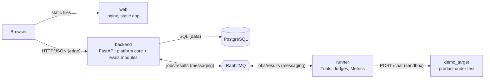

# Architecture — Ethera Eval Platform (PoC)

What runs where and why. Rules that govern it live in `.claude/rules/architecture.md`; the
decisions behind it in `docs/DECISIONS.md`. This page describes the target of the slices;
the **Status** column says what exists after Phase A1.

## Services (modular monolith)



| Service | Based on | Responsibility | Networks | Status after A1 |
|---|---|---|---|---|
| `backend` | template_core `backend/` + `evals` modules | HTTP API, all domain logic, owns the DB, publishes eval jobs, consumes results, periodic Model Watch | edge, data, messaging | core only (identity, access, rate limiting, broker connection) |
| `runner` | template_core `llm/`, renamed | Executes Trials against the sandbox target, applies Metrics, publishes results; no DB, no ports | messaging, sandbox | connects, declares topology, heartbeat; no handler yet (D-006) |
| `demo_target` | new, minimal FastAPI | The product under test, configured per Candidate | sandbox | slice 002 |
| `postgres`, `rabbitmq` | template_core | Data; the only channel backend ↔ runner | data; messaging | as template |
| `web` | template_web | Dashboard and actions | web | identity screens only |

The `sandbox` network is internal: runner and demo target only, no route to the database,
the broker or the internet. For the PoC the sandbox is the `demo_target` container started
with the Candidate's model, instruction-set version and retrieval mode, behind a
`SandboxLauncher` port; the per-run-container and `repository_dispatch` adapters are named
in the decision log only.

## Code layout

```
ethera-eval-core/
  backend/      platform core (template): app, auth, users, roles, messaging, health,
                settings, errors; audit and spend arrive with their first writers
  evals/        domain modules, one package each, created by the add-module skill:
                registry, evaluation, comparison, model_watch, notification
                + MODULES.py (append-only mount registry) + app.py (composition root)
  runner/       worker (template llm/), generic job loop, heartbeat
  demo_target/  the product under test (imports nothing from this repository)
  common_lib/   envelope, errors, logging, schemas, core ORM models
  migrations/   core migrations (template); modules carry their own migration packages
  tests/        mirrors the source tree
ethera-eval-web/
  src/features/ one feature per backend module (+ auth, profile, users)
  src/pages/    pages compose features; PROTECTED_PAGES drives routes and navigation
```

## Dependency rules (enforced)

- `backend` never imports `evals`; core boots without it (test).
- Inside a module: `api → services → repositories → domain`; `domain` is pure.
- Modules talk through barrels along `docs/domain/context-map.md`.
- `runner`, `demo_target` never import `backend` or `evals`; `runner` has no ORM.
- Web features never import each other (ESLint `FEATURES`).

## Messaging

One direct exchange `evals` with DLX `evals.dlx`; quorum queues `runner.jobs` and
`backend.runner.results`, each with a dead-letter queue; delivery limit 3; versioned
envelope with request ID; publisher confirms; at-least-once with idempotent handlers. Message
types (names given by the brief): `EvalTrialBatchRequested`, `TrialBatchCompleted`; their
payloads are slice 003's contract.

## Observability

Three planes never mixed: audit (DB, same transaction), technical logs (stdout JSON with
correlation fields from contextvars), metrics (internal `/metrics`). Production adapter for
logs and metrics: Ethera's internal framework (recorded, not built).
