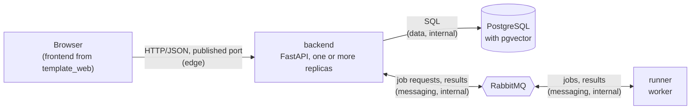

# ethera-eval-core

## Overview

The backend API, the runner (the worker that will execute evaluation Trials) and the shared
Python library of the Ethera Eval Platform, together with the PostgreSQL (with pgvector) and
RabbitMQ services they run on. Built from
[template_core](https://github.com/yordan-gergov01/template_core) (commit `e1d773d`); the
frontend lives in `../ethera-eval-web` (from
[template_web](https://github.com/yordan-gergov01/template_web)) and talks only to the
backend's HTTP API. Repository-wide decisions: `../docs/DECISIONS.md`; the template's own
decisions, kept as history, are in `docs/DECISIONS.md` below.

## Prerequisites

- To run: Docker with Compose v2 (`docker compose`). Nothing else is required.
- For local development: Python 3.12 with pip.

## How to start

1. Create your environment file from the example:

   ```bash
   cp .env.example .env
   ```

   The values in `.env.example` are development placeholders. Change every password before
   any shared use.

2. Start everything in the background:

   ```bash
   docker compose up -d
   ```

3. Check that every service reports `healthy`:

   ```bash
   docker compose ps
   ```

The backend is then available on the host port set by `BACKEND_PORT` (default 8000):

| URL | What it is |
|---|---|
| `http://localhost:8000/api/v1` | The API; every business endpoint lives under this prefix |
| `http://localhost:8000/health` | Health check: 200 when the database is reachable, 503 otherwise |
| `http://localhost:8000/docs` | Interactive API documentation (switch off with `ENABLE_API_DOCS=false`) |

The backend is the only service with a published port. PostgreSQL and RabbitMQ are reachable
only from the containers on their internal networks.

To stop the services and keep the data:

```bash
docker compose down
```

To stop them and delete all data (database and broker volumes):

```bash
docker compose down -v
```

Database credentials are applied only when the database volume is first created. After
changing any `POSTGRES_*` value in `.env`, reset the volumes with `docker compose down -v`.
RabbitMQ users and permissions are applied on every start.

## Default login

On the first start the backend creates an admin account from `.env`:

| Setting | Value in `.env.example` |
|---|---|
| `ADMIN_USERNAME` | `admin` |
| `ADMIN_PASSWORD` | `dev-only-change-this-admin-password` |

Change both before any shared use. The password must be 12 to 128 characters long and not a
commonly used password; otherwise the backend refuses to start and names the problem.

The account is created only if it does not exist yet and is never updated afterwards, so
changing `ADMIN_PASSWORD` later has no effect on an existing database. To start over with new
admin credentials, reset the data with `docker compose down -v`.

To log in from the API documentation, open `http://localhost:8000/docs`, choose **Authorize**
and enter the username and password. From the command line:

```bash
curl -X POST http://localhost:8000/api/v1/auth/login -d "username=admin&password=dev-only-change-this-admin-password"
```

The response contains a bearer token valid for `ACCESS_TOKEN_EXPIRE_MINUTES` (default 30).
Usernames are not case-sensitive. `POST /api/v1/auth/logout` revokes every token of the user,
on every device.

## Using the API

The examples use a token from the login above in `$TOKEN`; `/docs` lists every endpoint with
its permission, request and response. [Request flows](#request-flows) explains what happens
behind them.

### Permissions

Endpoints check permissions, never role names. Each request loads the caller's permissions
from the database, so a change of role or a deactivation applies to the next request.

| Permission | admin | user |
|---|---|---|
| `users:read`, `users:create`, `users:update` | yes | no |

The `user` role holds no permissions yet; the domain modules add theirs as they arrive.

Every signed-in user can also read and change their own profile (`/api/v1/users/me`) and
password (`/api/v1/users/me/password`). Account rules are in
[D-007](docs/DECISIONS.md#d-007-user-accounts-and-administration).

### Messaging and the runner

The template's prompt jobs and model switch were removed (`../docs/DECISIONS.md` D-004). The
messaging machinery they used — publisher confirms, consumers with dead-letter handling, the
runner's job loop, long polling through PostgreSQL `NOTIFY` — is kept payload-generic and is
wired by slice 003 for `EvalTrialBatchRequested` / `TrialBatchCompleted` (D-006). Until then
the backend only connects to the broker and declares the queues, and the runner connects,
declares them and keeps its heartbeat.

### Seeing a 429

Every `/api/v1` request counts against 120 per minute per user (per client address when not
signed in), and login also against 5 per minute per address and username; the
`RATE_LIMIT_*` settings change these, and [D-008](docs/DECISIONS.md#d-008-rate-limiting)
explains the design. Six wrong passwords within a minute: the first five get 401, the sixth
429 with `Retry-After`. Every login attempt for the same username from the same address
within the window counts, successful ones included, so shortly after a successful login the
429 can come before the sixth attempt.

```bash
for i in 1 2 3 4 5 6; do curl -s -o /dev/null -w "%{http_code} " -X POST http://localhost:8000/api/v1/auth/login -d "username=admin&password=not-the-password"; done; echo
```

The default limit, from a shell (Linux, macOS, Git Bash): 401 until the 120 requests of the
minute are used up, then 429. Requests sent shortly before, such as the logins above, count as
well.

```bash
for i in $(seq 1 125); do curl -s -o /dev/null -w "%{http_code} " http://localhost:8000/api/v1/users/me; done; echo
```

The same from Windows PowerShell:

```powershell
1..125 | ForEach-Object { try { (Invoke-WebRequest http://localhost:8000/api/v1/users/me -UseBasicParsing).StatusCode } catch { [int]$_.Exception.Response.StatusCode } }
```

For a shorter demo, lower the limit for one run of the backend. A variable set in the shell
takes precedence over `.env`:

```bash
RATE_LIMIT_DEFAULT_REQUESTS=5 docker compose up -d backend
```

In PowerShell, set `$env:RATE_LIMIT_DEFAULT_REQUESTS=5` before the same `docker compose up -d
backend`. To go back to the value in `.env`, run `docker compose up -d backend` again from a
shell without the variable.

## How to run the tests

### With Docker only

The tests run against their own PostgreSQL and RabbitMQ in a separate compose project, which
never touches the development stack or its data:

```bash
docker compose -f docker-compose.test.yml -p ethera_eval_core_test up -d --wait postgres rabbitmq
```

```bash
docker compose -f docker-compose.test.yml -p ethera_eval_core_test run --rm --build tests
```

```bash
docker compose -f docker-compose.test.yml -p ethera_eval_core_test down -v
```

The test runner is built from the `test` stage of `backend/Dockerfile`, so the production
image never contains test dependencies. Inside Docker, integration tests fail if the database
or the broker is missing; they are never skipped.

### Local development setup

Create a virtual environment with Python 3.12 and activate it.

On Windows (PowerShell):

```powershell
py -3.12 -m venv .venv
.venv\Scripts\Activate.ps1
```

On Linux or macOS:

```bash
python3.12 -m venv .venv
source .venv/bin/activate
```

Then install the pinned tools and dependencies, make the project packages importable, and
install the Git hooks:

```bash
python -m pip install --upgrade pip
pip install --require-hashes -r requirements/dev.txt
pip install -e . --no-deps
pre-commit install
```

Keep the virtual environment active when committing: the mypy and import-linter hooks run from
it.

### Running the tests and linters

Start the test database and broker (see above; they listen on `127.0.0.1:55432` and
`127.0.0.1:55672` only), then:

```bash
pytest
```

Without them, the integration tests are skipped with a message that says how to start them;
the unit tests still run.

All checks that run on every commit can be run at once:

```bash
pre-commit run --all-files
```

Or individually:

```bash
ruff format --check .
ruff check .
mypy
lint-imports
```

## Development and operations

### Adding or upgrading a dependency

pip installs every dependency, in the containers and locally. Each requirements group has a
`.in` file with the direct dependencies and a compiled `.txt` file in which every package,
including transitive ones, is pinned with hashes. The `.txt` files are compiled with uv, which
resolves for all platforms at once, so the same files work on Windows, macOS and Linux.

| Group | Used by |
|---|---|
| `requirements/backend.in` | the backend image |
| `requirements/runner.in` | the runner image |
| `requirements/demo_target.in` | the demo target (constrained by `backend.txt`; its image arrives in slice 003) |
| `requirements/dev.in` | local development: the services plus the tooling |

To add a dependency, add it to the right `.in` file and recompile. Compile in this order,
because `demo_target.in` is constrained by `backend.txt` and `dev.in` by the service files:

```bash
uv pip compile --universal --generate-hashes --python-version 3.12 requirements/backend.in -o requirements/backend.txt
uv pip compile --universal --generate-hashes --python-version 3.12 requirements/runner.in -o requirements/runner.txt
uv pip compile --universal --generate-hashes --python-version 3.12 requirements/demo_target.in -o requirements/demo_target.txt
uv pip compile --universal --generate-hashes --python-version 3.12 requirements/dev.in -o requirements/dev.txt
```

To upgrade one package to its newest allowed version, add `--upgrade-package <name>` to the
commands above. Then reinstall with `pip install --require-hashes -r requirements/dev.txt`,
run the tests, and commit the `.in` and `.txt` files together.

### Changing the database schema

The schema is managed with Tortoise ORM's built-in migrations in `migrations/`. The backend
applies pending migrations at startup. After changing a model in `common_lib/models`, generate
the migration against the running test database and review the SQL before committing:

```bash
export DB_HOST=127.0.0.1 DB_PORT=55432 DB_NAME=ethera_eval_test DB_USER=ethera_eval_app DB_PASSWORD=test-only-not-a-secret \
  DB_OWNER_USER=ethera_eval_owner DB_OWNER_PASSWORD=test-only-not-a-secret
```

```bash
tortoise makemigrations --name <short_description>
```

```bash
tortoise sqlmigrate models <migration_name>
```

On Windows (PowerShell), set the variables with `$env:DB_HOST='127.0.0.1'` and so on.

### Inspecting the dead-letter queues

A message that cannot be processed ends in a dead-letter queue instead of being lost or
retried forever:

| Queue | What lands there | What happens |
|---|---|---|
| `runner.jobs.dlq` | Job requests the runner rejected, or that crashed it three times | From slice 003: the backend consumes it and fails the job with `UNDELIVERABLE` |
| `backend.runner.results.dlq` | Results the backend could not read or apply | Kept for inspection |

Show how many messages each queue holds:

```bash
docker compose exec rabbitmq sh -c 'rabbitmqctl -q list_queues -p "$RABBITMQ_VHOST" name messages'
```

Read up to ten dead-lettered results, with the reason in the `x-death` header, without
removing them (`ack_requeue_true` puts them back):

```bash
docker compose exec rabbitmq sh -c 'rabbitmqadmin --username "$RABBITMQ_INSPECTOR_USER" --password "$RABBITMQ_INSPECTOR_PASSWORD" --vhost "$RABBITMQ_VHOST" get messages --queue backend.runner.results.dlq --count 10 --ack-mode ack_requeue_true'
```

The inspector user may only read the two dead-letter queues. The broker has no published
port, so this works only from the Docker host, and the credentials never leave the
container's environment.

## Architecture summary



### Components

| Component | Responsibility |
|---|---|
| `backend/` | The only HTTP API (`/api/v1`, `/health`, `/docs`). Authentication, permissions, users and rate limiting; the domain modules in `evals/` are mounted into it by `evals.app`. Applies migrations, runtime grants and the seeds (roles, permissions, the admin account, then each module's seed) at startup as the migration owner, under the startup lock; serves requests as the runtime role. Connects to the broker and declares the queues; publishing and consuming are wired in slice 003. |
| `runner/` | A plain asyncio worker with no ports and no database access. Connects to the broker, declares its queues and keeps a heartbeat; from slice 003 it consumes Trial batches, runs them against the sandbox target, publishes the results, then acknowledges the job. |
| `common_lib/` | Code both services import: settings base, error codes, logging, permissions, ORM models, request schemas, and the message contract (envelope, payloads, queue topology). |
| PostgreSQL | Users, roles, permissions and the rate-limit counters, then the domain modules' tables (prefixed per module). Will wake waiting requests through `LISTEN/NOTIFY` (slice 003). |
| RabbitMQ | The only channel between the backend and the runner: one direct exchange, a quorum queue per direction, and a dead-letter queue for each. |

Inside the backend, dependencies point one way: `api` (HTTP only) → `services` (business
rules, no HTTP) → `dal` (every query). import-linter checks these rules on every commit.

### Communication rules and network layout

| Network | Members | Purpose |
|---|---|---|
| `edge` | backend | The only network with a published port (`BACKEND_PORT`, default 8000) |
| `data` (internal) | backend, postgres | Only the backend reaches the database |
| `messaging` (internal) | backend, rabbitmq, runner | The backend and the runner talk only through the broker |

PostgreSQL, RabbitMQ and the runner publish no ports. The frontend container joins none
of these networks: the browser calls the backend's published port, and nothing outside the
stack can reach the broker, the database or the runner. The internal networks have no
route to the internet.

### Request flows

**Login.**

1. `POST /api/v1/auth/login` with form data, rate limited per address and username.
2. The backend verifies the password with Argon2id off the event loop, against a dummy hash for
   unknown usernames, so timing reveals no accounts; every failure is the same 401.
3. It returns a signed token (HS256, 30 minutes) carrying only the user ID and token version.
4. Every later request loads the user and permissions from the database and checks the token
   version: no valid token is 401, a missing permission 403. Logout and a password change
   increment the version, which ends every session of the user.

**Jobs (from slice 003).** The template's reliable-job flow (store first, publish with a
confirm, results applied idempotently, `NOTIFY` wakes long polls on every replica, stale jobs
timed out by a sweeper — [D-010](docs/DECISIONS.md#d-010-reliable-job-processing)) returns
for Eval Runs; the generic pieces are already here and tested.

### Security model

- **Identity:** Argon2id password hashes and a length-based password policy; short-lived
  tokens with no permissions inside, so permissions, role changes and deactivations are read
  from the database on every request. No default credentials.
- **Authorization:** endpoints check permissions, never role names.
- **Input and abuse:** unknown fields are rejected, bodies are limited to 1 MiB, CORS allows
  only `CORS_ALLOWED_ORIGINS`, and every `/api/v1` request is rate limited.
- **Least privilege:** two non-superuser database roles (D-021): a migration owner (BYPASSRLS)
  used only at startup to migrate, grant and seed, and a runtime role (NOBYPASSRLS, data grants
  only, audit rows INSERT + SELECT only) that serves every request; local volumes created
  before this split need `docker compose down -v` once. One broker user per service, internal
  networks, and containers that run as non-root, read-only and with dropped capabilities.
- **Secrets and supply chain:** secrets come from the environment only and are never logged;
  images are pinned by digest and packages by hash. `/docs` is public while
  `ENABLE_API_DOCS` is true.

### Error handling and logging

Every error response is [RFC 9457](https://www.rfc-editor.org/rfc/rfc9457) problem details
(`application/problem+json`) with a stable `code` and the `request_id`. Services raise errors
by meaning, and one module maps them to status codes. An unexpected error returns a generic 500
and is logged once with its full traceback; an unreachable database is a 503 with
`Retry-After`.

Both services log JSON lines to stdout (`LOG_FORMAT=console` locally) with a UTC timestamp,
level, service, request ID and user ID. The request ID comes from `X-Request-ID` or is
generated, is returned to the client and travels in every message, so one request can be
followed through both services. Secrets are never logged, sensitive keys are redacted as a
safety net, and free text is logged by length only.

## Scaling and deployment

### Scaling

The backend keeps no state in memory that other replicas would need, so it can run as several
replicas. Give each replica its own host port:

```bash
BACKEND_PORT=8000-8001 docker compose up -d --scale backend=2
```

When several replicas start at once, a PostgreSQL advisory lock lets exactly one of them apply
migrations. Each replica opens up to `DB_POOL_MAX_SIZE` database connections (default 10), so
replicas x `DB_POOL_MAX_SIZE` must stay below PostgreSQL's `max_connections` (100 by default),
with room for the migration connection at startup.

The client address used for rate limiting is the connection's address. Behind a reverse
proxy, list the proxy's address or network in `TRUSTED_PROXIES` (for example
`172.18.0.0/16`) so that its `X-Forwarded-For` header is used; it is ignored from anyone else.

## Extending the project

### Adding an endpoint

Each feature has one package per layer, and dependencies point one way only:
`api` -> `services` -> `dal`. The user endpoints are a complete example.

1. **Schemas:** request bodies in `common_lib/schemas/<feature>.py`, with
   `extra="forbid"` so unknown fields are rejected.
2. **Data access:** queries in `backend/dal/<feature>/repository.py`. Repositories return
   plain records, never ORM objects.
3. **Service:** business rules in `backend/services/<feature>/service.py`. The service
   declares the small `Protocol` it needs from the repository, raises errors from
   `common_lib.errors` (never HTTP errors), and has a `build_<feature>_service()` function
   that wires the real repository.
4. **Route:** in `backend/api/v1/<feature>/router.py`, declaring its permission with
   `dependencies=[require_permissions(Permission.X)]`; include the router in
   `backend/api/v1/router.py` and add a `get_<feature>_service` dependency in
   `backend/api/dependencies/services.py`.
5. **Tests:** service rules with fakes in `tests/unit/backend/`, the endpoint against the
   real database in `tests/integration/`.

The import contracts in `pyproject.toml` (checked by `lint-imports` and the test suite) fail if
a route imports the data access layer or the ORM directly.

### Adding a permission

Add a member to `Permission` in `common_lib/permissions.py`, grant it to roles in
`DEFAULT_ROLE_GRANTS`, and require it on the endpoint. The backend syncs permissions and grants
to the database on the next start; no migration is needed.

### Adding a domain module

Domain modules live in `evals/<module>/` (`api → services → repositories → domain`, each with
its own Tortoise app label and migrations package) and are mounted by appending one
`ModuleMount` to `evals/MODULES.py`; the backend never imports them. Use the repository's
`add-module` skill (`../.claude/skills/add-module/SKILL.md`), which also adds the import
contracts and the mirrored web feature.

## Decisions

The choices made where the brief leaves the answer open, each with its reason, are recorded in
[docs/DECISIONS.md](docs/DECISIONS.md).
